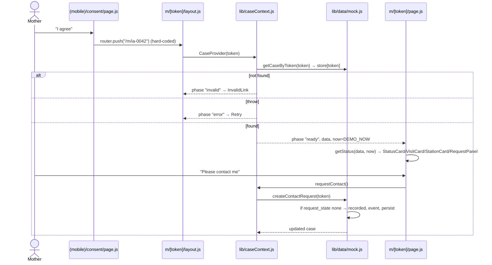
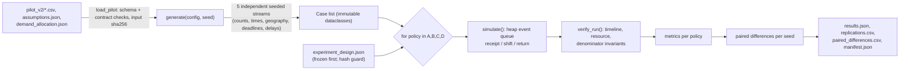

# Data flow and critical execution paths

All web paths below run entirely in the browser. "Persist" means `mock.js:persist()` writing the whole store to `localStorage["inaalaga-mock-store-v1"]`. There is no network request in mock mode except static assets.

## Shared mechanics

- **Data source switch** (`web/src/lib/data/index.js:4`): `NEXT_PUBLIC_DATA_SOURCE === "supabase"` selects `supabase.js` (every call throws); anything else selects `mock.js`. Inlined at build time.
- **Read pattern** (pages/components): `useEffect` → data call → `setState`; `null`/`undefined` while loading; `failed` flag with Retry. Mutations are wrapped by `useSave` (`components/bhw/useSave.js`) or local `saving` state; UI changes only after the promise resolves.
- **Latency**: every mock function `await wait(200–500ms)` to simulate a network.
- **Hydration**: first data call in a page load runs `hydrate()` once (`mock.js:136`), replacing the in-memory seed with any saved store. Later calls never re-read storage.
- **Clock**: `getDemoNow()` returns the frozen `DEMO_NOW`; every event and audit field written by mock uses it.
- **Overlays are URL-driven**: `?case=ID` opens `SlideOver`, `?new=1` opens the discharge `Modal`; closing pushes the bare path.

## 1. Hospital records a discharge (PRD H01/H02)

```mermaid
sequenceDiagram
  actor Staff as Hospital staff
  participant List as hospital/patients/page.js
  participant Dlg as DischargeDialog.js
  participant Val as lib/validation.js
  participant Geo as lib/demoGeography.js
  participant Mock as lib/data/mock.js
  Staff->>List: click "+ Record discharge" (router.push ?new=1)
  List->>Dlg: open=true
  Staff->>Dlg: alias, barangay, birth, discharge, due (datetime-local)
  Dlg->>Geo: lookupStation(barangay) (live suggestion card)
  Staff->>Dlg: "Review handoff"
  Dlg->>Val: validateDischarge(values)
  alt errors
    Val-->>Dlg: field errors (stay in edit step)
  else valid
    Dlg-->>Staff: review step
    Staff->>Dlg: "Save discharge"
    Dlg->>Dlg: keyRef ??= crypto.randomUUID()
    Dlg->>Mock: createDischarge({..., *_at: toManilaIso(), idempotency_key})
    Mock->>Mock: duplicate key? return {duplicate:true}
    Mock->>Mock: re-validate required fields and ordering
    Mock->>Geo: lookupStation → station or null
    Mock->>Mock: id = IA-(42 + count of IA- cases); handoff_state pending|unassigned
    Mock->>Mock: persist()
    Mock-->>Dlg: {case, duplicate:false}
    Dlg-->>Staff: saved step (assigned or "Station not assigned")
    Dlg->>List: onSaved → refetch listCases()
  end
```

- Validation (`validation.js:25-38`): all five fields required; discharge ≥ birth; due ≥ discharge. Times are interpreted as `+08:00` by string concatenation (`toManilaIso`).
- Server-equivalent checks repeat in `createDischarge` (`mock.js:352-383`). Barangay is not checked against a list; anything not in `BARANGAYS` becomes `unassigned`.
- Errors: any throw → "Couldn't save the record. Your entries are kept." The same idempotency key is reused on retry; it resets when the dialog closes or "Record another discharge" is pressed.
- No event is appended on creation; the BHW `EventHistory` synthesises "Discharge recorded" and "Assigned to …" rows from `recorded_at`/`assigned_at`.
- Tests: none (web has no tests).

## 2. BHW accepts responsibility (PRD W01/W02)

1. `/bhw` (`app/bhw/page.js:39-51`) calls `listStationCases(worker.station)`; results filtered to `IA-` IDs at that station and sorted by `due_at`, then `recorded_at ?? discharge_at`, then `id` (`mock.js:210-222`).
2. Row click → `/bhw?case=IA-0042` → `SlideOver` → `CaseDetail` (`components/bhw/CaseDetail.js`) → `getCaseById` (any station; no scope check).
3. `CaseDetail` computes `otherStation` and `canAccept` (`CaseDetail.js:77-79`); buttons are hidden for other-station cases. This is the **only** scope control.
4. "Accept responsibility" opens a `Modal` with `AcceptCard` → `useSave(acknowledgeCase)` → `acknowledgeCase(id, {worker_name})` (`mock.js:238-253`):
   - unassigned → throw "No station assigned";
   - already acknowledged by another worker → throw "Owner conflict" (rendered as a dedicated card);
   - already acknowledged by same worker → returns unchanged (idempotent);
   - else sets `handoff_state`, `owner_worker`, `acknowledged_at = DEMO_NOW`, pushes event `accepted`, persists.
5. `onSaved` replaces local case state, closes the modal and triggers list refresh.

## 3. Schedule → outcome

- `ScheduleForm` defaults to `due_at`; rejects empty and before-discharge client-side; `scheduleVisit` (`mock.js:255-274`) requires acknowledged, not before discharge, no other open scheduled visit; adds `{id:"v<n>", state:"scheduled", location_type:"home", worker_name, scheduled_at}`.
- `bhwState` (`lib/bhwStatus.js:5-12`) shows `update_needed` once `scheduled_for < DEMO_NOW`.
- `VisitOutcomeForm` defaults start = `scheduled_for`, end = +30 min; `recordVisitOutcome` (`mock.js:276-293`) requires an open visit, `outcome === "completed"`, start ≥ discharge, end ≥ start. It does **not** check against the demo clock, the acting worker, or station.
- `/bhw/schedule` lists scheduled visits whose `worker_name` equals the selected worker (`mock.js:224-236`).

## 4. Mother views status and requests contact (PRD M01/M02/R01)



- **Token = store key**: seed keys are lowercase case IDs (`ia-0042`) and four `preview-*` fixtures (`mock.js:74-123`). Cases created by the hospital are stored under `id.toLowerCase()` and are therefore reachable at `/m/ia-0048` etc.
- Status mapping (`lib/status.js`): unassigned → completed (any completed visit) → pending (not acknowledged) → acknowledged (no scheduled visit) → overdue (scheduled visit time < now) → scheduled. "Overdue" here is based on `scheduled_for`, not `due_at`.
- `RequestPanel` shows recorded/acknowledged states; failures show "Couldn't save your request." and keep the button.
- The mother page does not poll; it shows a BHW acknowledgment only after reload or route remount.

## 5. BHW acknowledges a request; contact attempts

- `ContactRequestCard` → `acknowledgeRequest` (`mock.js:295-306`): requires `request_state === "recorded"`; sets `request_acknowledged_by/at`. No station or ownership check.
- `ContactAttemptForm` → `recordContactAttempt` (`mock.js:308-332`): validates outcome enum and end ≥ start; appends to `contact_attempts`; never changes visit state. No handoff/station check (works on unassigned cases).

## 6. Reset

`/bhw` footer button → `resetDemoData()` (`mock.js:159-169`): restores `SEED`, clears the idempotency map, removes the localStorage key. Affects only the current browser.

## 7. Simulation pipeline (offline)



- Dispatch rules (`model.py:219-250`): pop all same-time events, then for each station sort the queue (FIFO by receipt/ID or EDF by due/receipt/ID); each idle worker takes the head only if the whole round trip fits in the shift; a non-fitting head blocks the queue (no bypass).
- Metrics (`summarize_cases`, `model.py:174-187`): primary `on_time_rate` = on-time completions / all introduced new cases; backlog reported separately.
- Error paths: `Config.validate`, `simulate` input validation and `load_pilot` raise `ValueError`; `verify_run` uses `assert` (disabled under `python -O`).
- Tests: `tests/test_simulation.py` (hand queues, boundaries, controls, pairing), `tests/test_factorial.py` (grid coverage, cohort identity).

## Failure boundaries

| Boundary | Behaviour |
| --- | --- |
| `localStorage` unavailable | Silently falls back to in-memory seed (try/catch in `hydrate`/`persist`) |
| Supabase mode | Every call throws → pages show their load-failed/Retry states; `getDemoNow` returns real time |
| Unknown case ID | `getCaseById` → null → "This record was not found."; `getCaseByToken` → InvalidLink |
| Corrupt stored JSON | `JSON.parse` throws inside try → seed used; a structurally wrong but parseable object is accepted as-is |
