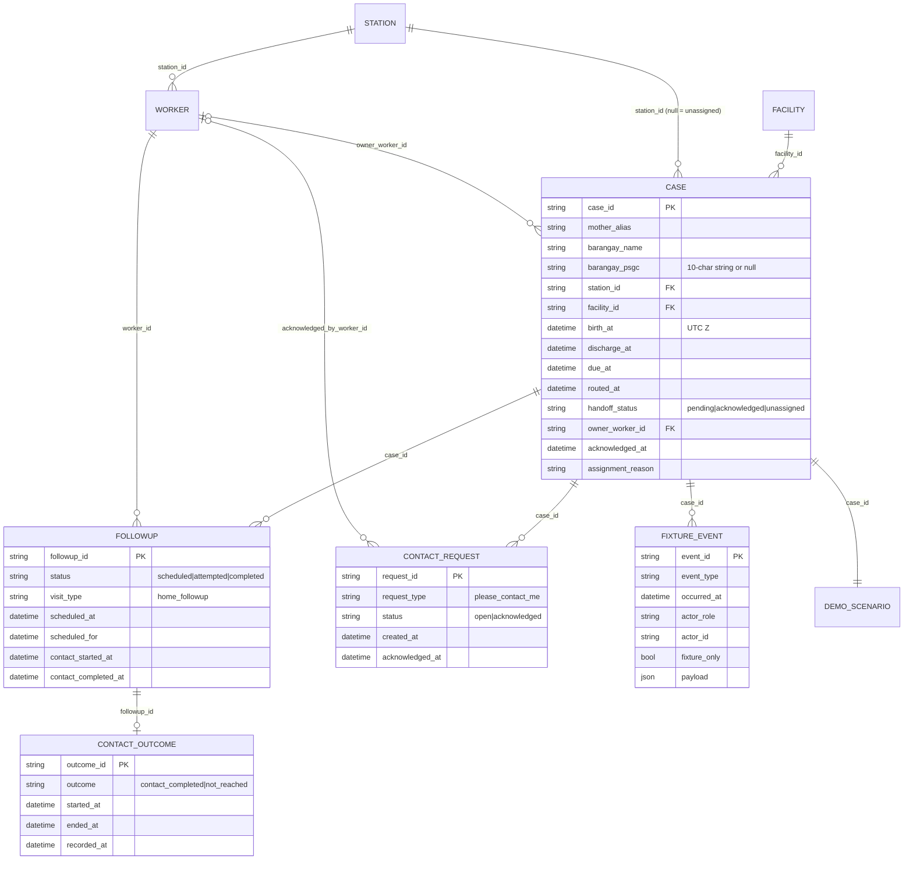

# Data model

There is **no database** in the repository: no schema, migrations, SQL or Supabase project files (**Verified**). Four distinct data models exist and must not be confused.

| Model | Where | Persistence | Status |
| --- | --- | --- | --- |
| A. Web mock case store | `web/src/lib/data/mock.js` | Browser `localStorage` | Live in the app |
| B. App seed fixtures | `data/app_demo/seed_v1.json`, `seed_populated_v1.json` | JSON files | Validated; **not loaded by the app** |
| C. Planned database | `docs/InaAlaga_PRD.md` §8 | — | Documented only |
| D. Simulation | `simulation/model.py`, `simulation/results/**` | CSV/JSON files | Implemented |

## A. Web mock store (actual runtime model)

`store` is an object keyed by token/lookup key (lowercase case ID or `preview-*`). Each value is a denormalised case document. Shape assembled from `makeCase` (`mock.js:5-16`) and the mutators:

```
Case {
  id: "IA-0042"                       // display/stable ID; "PV-n" for preview fixtures
  alias, barangay, station_name|null  // station_name is the display string, e.g. "Tanza BHS (demo station)"
  handoff_state: "unassigned"|"pending"|"acknowledged"
  request_state: "none"|"recorded"|"acknowledged"
  owner_worker|null, acknowledged_at|null
  birth_at, discharge_at, due_at      // ISO with +08:00 offset
  recorded_at?, assigned_at?          // only on cases created through createDischarge
  request_recorded_at?, request_acknowledged_by?, request_acknowledged_at?
  visits: [ { id:"v<n>", state:"scheduled"|"completed", scheduled_for, location_type:"home",
              worker_name, scheduled_at?, started_at?, ended_at?, outcome?, completed_recorded_at? } ]
  contact_attempts: [ { id:"a<n>", method, started_at, ended_at, outcome:"reached"|"not_reached",
                        worker_name, recorded_at } ]
  events: [ { at, type, actor, detail } ]   // types: request_recorded, accepted, visit_scheduled,
                                            // visit_completed, request_acknowledged, contact_attempt
}
```

Rules enforced in `mock.js` (the only "constraints" that exist):

| Rule | Function |
| --- | --- |
| Required fields; `discharge_at ≥ birth_at`; `due_at ≥ discharge_at` | `createDischarge` |
| Idempotency per `idempotency_key` (in-memory `Map`, lost on reload) | `createDischarge` |
| Unknown barangay → `unassigned`, `station_name: null` | `createDischarge` via `lookupStation` |
| One owner; different worker → "Owner conflict" | `acknowledgeCase` |
| Schedule only after acceptance, not before discharge, one open visit | `scheduleVisit` |
| Completion only from an open visit; start ≥ discharge; end ≥ start | `recordVisitOutcome` |
| Request ack only from `recorded` | `acknowledgeRequest` |
| Attempt end ≥ start; outcome enum | `recordContactAttempt` |

Not enforced: station scope on any write, acting worker = owner/visitor, timestamps ≤ demo clock, attempts only on assigned cases. IDs: `IA-` + `42 + (number of IA- cases)`, zero-padded to 4 (`mock.js:364-365`); visit/attempt IDs are per-case counters.

States `attempted` and `cancelled` appear in `web/CLAUDE.md`'s case shape and the PRD but no mock function produces them; an unsuccessful contact is modelled as a `contact_attempts` entry instead.

Lifecycle: seeded at module load → optionally replaced by saved store on first call → mutated in place → whole store re-serialised on each write → `resetDemoData` restores the seed. No deletion of individual records exists.

### Divergence from the canonical seed (Verified)

`mock.js` hand-copies the six clean-seed cases but differs from `data/app_demo/seed_v1.json`:

| Case | Seed | Mock |
| --- | --- | --- |
| IA-0042 | matches | matches |
| IA-0043 | birth Oct 17 13:00, discharge Oct 18 13:00 | birth Oct 18 14:00, discharge Oct 19 10:30 |
| IA-0044 | Linao West; birth Oct 18 06:00, discharge Oct 19 06:00 | Atulayan Norte; birth Oct 19 02:00, discharge Oct 19 09:00 |
| IA-0045 | Atulayan Norte | Linao West |
| IA-0046 | birth Oct 18 07:30, discharge Oct 19 07:30 | birth Oct 18 20:00, discharge Oct 19 10:00 |
| IA-0047 | "Demo Mother 08", birth Oct 17 10:00, discharge Oct 18 10:00 | "Carmela Tolentino", birth Oct 18 11:00, discharge Oct 19 10:45 |

(Manila times.) Due targets match. Mock also adds four `preview-*` mother fixtures that are not in any seed.

## B. App seed fixtures (relational-style JSON)



Top-level metadata: `schema_version` (1.0.0 clean / 1.1.0 populated), `dataset_id`, `fictional_data_only`, `display_timezone`, `demo_clock_at` (`2026-10-19T04:00:00Z`), `assignment_lookup_version` (`pilot_v2`). `FIXTURE_EVENT` and `DEMO_SCENARIO` exist only in the populated profile.

Validation (`validate_seed.py`, `validate_populated_seed.py`): unique IDs, references, UTC `Z` timestamps, `birth ≤ discharge ≤ due`, discharge ≤ clock, assignment matches `pilot_v2/barangays.csv`, worker belongs to the case's station and equals the owner, chronological outcome/request/event consistency, expected counts. Both pass (**Verified**).

Key naming differences from the mock: `case_id` vs `id`, `mother_alias` vs `alias`, `station_id` (`demo_tanza`) vs `station_name` (display string), `handoff_status` vs `handoff_state`, `owner_worker_id` vs `owner_worker` (display name), separate `followups`/`contact_outcomes`/`contact_requests` collections vs embedded arrays. An importer must map these.

## C. Planned database (PRD §8, Documented only)

`demo_sessions`, `stations`/`barangays`, `cases`, `followups`, `contact_requests`, `events` (append-only), `access_tokens` (hashed random token, case scope, expiry). Endpoints: `POST /api/demo/session`, `POST /api/cases`, `GET /api/cases[/id]`, action POSTs, `POST /api/demo/reset`, `GET /api/scenarios`. None exists.

## D. Simulation data

- Inputs: `data/geography/pilot_v2/barangays.csv` (5 rows, PSGC as 10-char strings), `stations.csv` (2), `travel_matrix.csv` (10 pairs, exactly 5 `assigned_station=True`), `assumptions.json`, `data/simulation/demand_allocation.json` (uniform 0.2). `load_pilot` (`model.py:82-121`) enforces counts, uniqueness, leading zeros, allocation contract and assignment consistency.
- `Config` (`model.py:20-57`): demand, days, workers, shift, service, travel multiplier, delay ranges, due windows, backlog. `validate()` rejects non-finite/negative/invalid ranges.
- `Case` (`model.py:60-69`): `case_id` `SYN-<seed>-NEW|BACK-<n>`, PSGC, station, discharge/due minutes, travel, service, `handoff_uniform`, `is_backlog`.
- Outcome per case: `received_minute`, `worker_id`, `departed_minute`, `contact_started_minute`, `contact_completed_minute`, `returned_minute`.
- Outputs per run folder: `experiment_design.json` (written first; hash-guarded), `results.json` (scenario → policy metric distributions, paired comparisons, subgroups), `replications.csv`, `paired_differences.csv`, examples, `manifest.json` (sha256 of every output plus inputs/sources).
- Simulation cohorts are deliberately unrelated to app cases; never seed the app from simulation results (`data/app_demo/README.md`).

## Privacy-relevant fields

Mother alias (fictional), barangay, birth/discharge timestamps. No phone, address, coordinates, symptoms or risk labels anywhere in models A, B or D (**Verified** by reading seeds and code).
