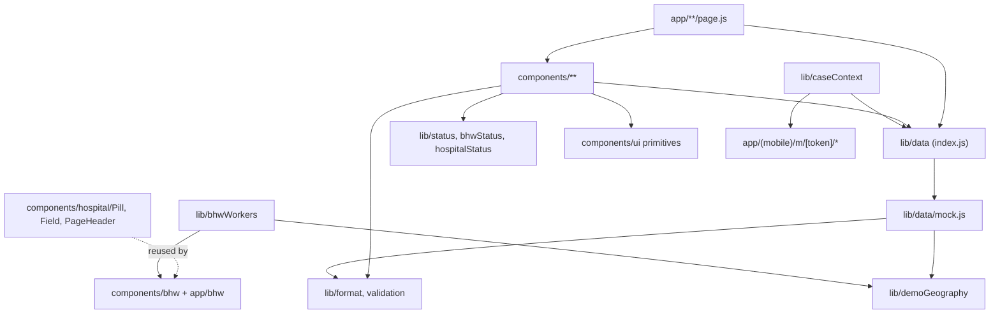

# Repository map

163 tracked files at commit `1944140`. Line counts are from the working tree.

## Directory tree (tracked files, grouped)

```
.
├── CLAUDE.md                     AI/contributor instructions (root)
├── README.md                     Team handoff index (dated Oct 18; says app unbuilt — stale)
├── HANDOFF_MANIFEST.json         71 path/bytes/sha256 entries for the curated Oct-18/19 handoff (stale, excludes web/)
├── .gitignore                    ignores .env*, __pycache__, audit/, *.gpkg, PHNR*, free-claude-code/
├── docs/
│   ├── InaAlaga_PRD.md           Product requirements v1.1 (current); .docx is the older v1.0
│   ├── TEAM_HANDOFF.md           Team context and decisions (Oct 19)
│   ├── FINAL_ASSUMPTIONS_REVIEW.md  Approved assumptions; app acceptance checklist (all unchecked)
│   ├── UI_AND_APP_SEED_HANDOFF.md   Figma link, seed profiles, remaining implementation
│   ├── FIGMA_ALIGNMENT_REVIEW.md    Historical review of old Figma exports
│   ├── FRONTEND_FIGMA_PROMPTS.md    Figma-to-code prompt playbook (historical; names recordContactOutcome)
│   ├── bhw_flowchart.png         BHW visual spec referenced by web/CLAUDE.md
│   └── architecture/             This knowledge base
├── web/                          Next.js app (run npm here)
│   ├── CLAUDE.md                 Frontend conventions, tokens, data-layer contract, PRD product rules
│   ├── README.md                 create-next-app boilerplate (mentions Geist; stale)
│   ├── package.json / package-lock.json   lockfile drifted (npm ci fails)
│   ├── next.config.mjs           Turbopack rule: *.css through @tailwindcss/turbopack
│   ├── eslint.config.mjs, jsconfig.json (@/* → src/*), .env.example
│   ├── public/                   unused create-next-app SVGs (0-line files)
│   └── src/
│       ├── app/
│       │   ├── layout.js         Root: Nunito, globals.css, <LangProvider>, html lang="en"
│       │   ├── globals.css       @theme tokens (brand-*, ink, muted, ok/warn/danger, attention)
│       │   ├── (mobile)/         Mother views, max-w 430px shell
│       │   │   ├── page.js       "/" entry: logo + "I am the mother" → /consent
│       │   │   ├── consent/page.js   Agree → /m/ia-0042 (hard-coded DEMO_TOKEN)
│       │   │   └── m/[token]/    layout.js (CaseProvider+Gate+BottomNav), page.js (Home),
│       │   │                     visits/ more/ (placeholders), station/ (StationCard)
│       │   ├── hospital/         layout.js (TopBar), page.js → redirect /hospital/patients,
│       │   │                     patients/page.js (list + ?case= SlideOver + ?new=1 DischargeDialog),
│       │   │                     patients/[caseId] and discharge/ → redirects
│       │   └── bhw/              layout.js (WorkerProvider+BhwShell), page.js (inbox + ?case= SlideOver),
│       │                         schedule/page.js, cases/[caseId] → redirect
│       ├── components/
│       │   ├── *.js              Mother components: StatusCard, VisitCard, RequestPanel, StationCard,
│       │   │                     WhyFollowUp, BottomNav, MotherHeader, LangToggle, DemoNotice, InvalidLink
│       │   ├── ui/               Primitives: Card, Badge, Button, Icon, AppBar(+RoleChip, Mark, Bell), Overlay(Modal, SlideOver)
│       │   ├── hospital/         TopBar, PageHeader, Pill, Field, PatientProfile, DischargeDialog
│       │   └── bhw/              BhwShell, CaseRow, CaseDetail, AcceptCard, ScheduleForm, VisitOutcomeForm,
│       │                         ContactRequestCard, ContactAttemptForm(+AttemptList), EventHistory, LoadState, useSave
│       └── lib/
│           ├── data/index.js     Data-source switch + re-exports (14 functions)
│           ├── data/mock.js      Seed store, localStorage persistence, all business rules
│           ├── data/supabase.js  14 stubs throwing "not implemented"
│           ├── status.js         Mother status (getStatus, getCardVisit)
│           ├── bhwStatus.js      BHW state + labels (bhwState, STATE_LABEL, visitLine, requestLine)
│           ├── hospitalStatus.js responsibility(), visitSummary()
│           ├── caseContext.js    CaseProvider/useCase for mother routes (lint error here)
│           ├── bhwWorkers.js     WORKERS, WorkerProvider/useWorker
│           ├── i18n.js           strings.fil / strings.en, LangProvider/useLang (default "fil")
│           ├── format.js         Asia/Manila formatting, initials, overdueLabel
│           ├── validation.js     validateDischarge, toManilaIso, toManilaLocalInput
│           └── demoGeography.js  TANZA, LINAO, OTHER_BARANGAY, BARANGAYS, lookupStation
├── simulation/
│   ├── model.py                  Config, Case, generate, receipt, simulate, summarize_cases, verify_run, load_pilot
│   ├── run.py                    30-config v1 suite CLI (--suite smoke|full)
│   ├── factorial.py              162-config factorial CLI
│   ├── factorial_report.py       Findings/CSV/heatmaps from factorial results
│   ├── README.md, FINDINGS.md    Model rules; v1 findings (says "19 unit checks", now 21)
│   ├── validation_report.json, factorial_validation.json   Recorded verification claims
│   ├── scenario_summary.csv      v1 compact summary
│   ├── results/v1/, results/factorial_v1/   Bundled outputs (large CSV/JSON)
│   └── reports/factorial_v1/     FINDINGS.md, CSVs, 3 PNG heatmaps, manifest
├── tests/
│   ├── test_simulation.py        19 hand-calculated/invariant tests
│   └── test_factorial.py         2 design-coverage tests
└── data/
    ├── app_demo/                 seed_v1.json (6 cases), seed_populated_v1.json (20), builder, 2 validators, docs
    ├── geography/                extract_tuguegarao.py (needs external .gpkg), build_pilot_v2.py,
    │                             pilot_v2/ (canonical inputs), tuguegarao_osm/ (GeoJSON), psa_tuguegarao/
    ├── simulation/demand_allocation.json   Uniform 20% per barangay contract
    ├── locations/tuguegarao_review/        Historical location review (script withheld)
    └── context/psa_ndhs_verification/      Published NDHS aggregates only
```

## Entry points

| Kind | Entry | Notes |
| --- | --- | --- |
| Web root | `web/src/app/layout.js` | Wraps every route in `LangProvider` |
| Mother | `/` → `/consent` → `/m/[token]` | Token = lowercase case ID key in mock store |
| Hospital | `/hospital` → `/hospital/patients` | `?case=ID`, `?new=1` |
| BHW | `/bhw`, `/bhw/schedule` | `?case=ID`; worker switcher in header |
| Simulation | `python -m simulation.run`, `python -m simulation.factorial`, `python -m simulation.factorial_report` | Run from repo root |
| Data | `python data/geography/build_pilot_v2.py`, `python data/app_demo/{validate_seed,validate_populated_seed,build_populated_seed}.py` | `validate_populated_seed.py` must be run from `data/app_demo/` or with that dir on `sys.path` (it does `from validate_seed import ...`) |

## Module relationships (web)



Notes: BHW screens import hospital primitives (`Pill`, `Field`, `PageHeader`) directly, so `components/hospital/` is effectively shared UI. `useSave.js` exports both a hook and shared button class strings.

## Important symbols

| Symbol | File:line | Purpose |
| --- | --- | --- |
| `source` | `web/src/lib/data/index.js:4` | Picks mock vs supabase at module load |
| `DEMO_NOW` | `web/src/lib/data/mock.js:1` | Frozen demo clock |
| `store`, `SEED` | `mock.js:18`, `mock.js:133` | Mutable store and pristine copy for reset |
| `hydrate` / `persist` | `mock.js:136`, `mock.js:150` | One-time load / whole-store save to localStorage |
| `createDischarge` | `mock.js:352` | Case creation, idempotency, station lookup, ID allocation |
| `acknowledgeCase` | `mock.js:238` | Ownership; "Owner conflict" |
| `recordVisitOutcome` | `mock.js:276` | Only path to a completed visit |
| `getStatus` | `web/src/lib/status.js:1` | Mother status derivation |
| `bhwState` | `web/src/lib/bhwStatus.js:5` | BHW status derivation |
| `useOverlay` | `web/src/components/ui/Overlay.js:9` | Escape/scroll-lock/focus for Modal and SlideOver |
| `useSave` | `web/src/components/bhw/useSave.js:6` | "Save is the boundary" wrapper |
| `simulate` | `simulation/model.py:190` | Event loop and dispatch |
| `verify_run` | `simulation/model.py:267` | Independent invariants run after every policy run |
| design hash guard | `simulation/run.py:65-67`, `simulation/factorial.py:55-57` | Refuses to write into a folder with a different design/source hash |

## Inspection coverage

- Read in full: every first-party source file in `web/src`, `web/*.json|mjs|example`, `simulation/*.py`, `tests/*.py`, `data/**/*.py`, all Markdown docs, `data/geography/pilot_v2/*` (small CSV/JSON), `data/simulation/demand_allocation.json`, validation JSONs.
- Inspected by structure/sampling: `package-lock.json` (root entry and key versions), `HANDOFF_MANIFEST.json` (hashes recomputed), seed JSONs (schema + case rows), simulation result CSV/JSON (headers and keys), GeoJSON (via scripts and READMEs).
- Not read: `docs/InaAlaga_PRD.docx` (older duplicate of the Markdown PRD), PNG images, `favicon.ico`, `public/*.svg` (0-line placeholders), full contents of multi-megabyte result CSVs.
