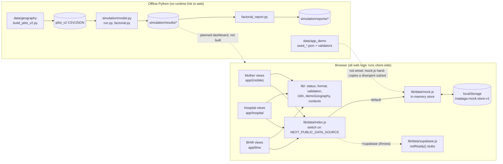

# Repository overview

Inspected 2026-10-22 at commit `1944140` (branch `main`). Evidence labels: **Verified** (read in code or executed), **Documented** (stated in docs only), **Inferred**, **Unknown**. See `INSPECTION_STATUS.md` for scope.

## Purpose

InaAlaga is a hackathon project (Team BAIthropic, UPLB; PJDSC 2026, submission due 2026-10-24 23:59 Asia/Manila; **Documented**, `docs/TEAM_HANDOFF.md`). It has two independent halves:

1. **A fictional hospital-to-community postnatal handoff demo** (Tuguegarao City): hospital staff record a discharge, a barangay health worker (BHW) at a demo station accepts responsibility, schedules a home follow-up and records outcomes, and the mother sees her status and can request contact.
2. **An offline discrete-event simulation** that compares handoff-delay and queue-order policies (A/B/C/D) for a hypothetical city maternal-health coordinator.

All patient and worker records are fictional. The project explicitly avoids risk scores, clinical triage, real SMS and real personal data (`docs/InaAlaga_PRD.md` §1, §8).

## Current state in one paragraph

The simulation is complete, tested and reproducible on LF checkouts (**Verified**: 21 tests pass, smoke run succeeds). The web app is a **client-only Next.js prototype running entirely on an in-browser mock data layer** (`web/src/lib/data/mock.js`) with `localStorage` persistence. Hospital and BHW workflows are substantially built; the mother view is partial; the coordinator dashboard, Supabase backend, API routes, authentication and scope enforcement do not exist (**Verified**). Lint currently fails on one error and `npm ci` fails on lockfile drift (**Verified**).

## Verified feature inventory

| Feature | Status | Where |
| --- | --- | --- |
| Hospital patient list with search/filters, profile slide-over | Implemented (mock) | `web/src/app/hospital/patients/page.js`, `components/hospital/PatientProfile.js` |
| Discharge form: edit → review → saved, validation, idempotency key, station lookup, unassigned path | Implemented (mock) | `components/hospital/DischargeDialog.js`, `lib/validation.js`, `lib/demoGeography.js` |
| BHW station inbox (desktop table / phone cards), filters, ordering "Earliest follow-up target first" | Implemented (mock) | `app/bhw/page.js`, `components/bhw/CaseRow.js` |
| BHW case detail: accept, schedule, record visit outcome, acknowledge request, contact attempts, event history | Implemented (mock) | `components/bhw/CaseDetail.js` and siblings |
| BHW worker switcher (Ana/Tanza, Bea/Linao West), Schedule page | Implemented (mock) | `lib/bhwWorkers.js`, `app/bhw/schedule/page.js` |
| Mother entry, consent, Home (status, visit, station, contact request), FIL/EN | Partial | `app/(mobile)/...`, `lib/i18n.js` |
| Mother Visits, More tabs | Placeholder ("This page is being built") | `app/(mobile)/m/[token]/visits/page.js`, `more/page.js` |
| Browser-local demo reset | Implemented | `mock.js:resetDemoData`, button on `/bhw` |
| Supabase data source | Stubs that throw | `lib/data/supabase.js` |
| Server API routes, auth, session/case/station scope | Absent | no `app/api/` |
| Coordinator operations + planning dashboard, scenario selector, map | Absent | — |
| Role launcher / simulated SMS inbox | Absent | `/` is the mother entry screen |
| Simulation engine, v1 grid (12,000 runs), factorial grid (64,800 runs), reports | Implemented | `simulation/` |
| Seed fixtures (clean 6-case, populated 20-case) with validators | Implemented, not wired to the app | `data/app_demo/` |
| Pilot geography pipeline (OSM/PSA → 5 barangays, 2 stations, travel matrix) | Implemented | `data/geography/` |

## Technology stack (Verified from manifests and imports)

| Layer | Technology | Evidence |
| --- | --- | --- |
| Web framework | Next.js 16.4.2 App Router, Turbopack | `web/package.json`, build output |
| UI runtime | React 19.3.0, plain JavaScript (`.js`), no TypeScript | `web/package.json`, `web/jsconfig.json` |
| Styling | Tailwind CSS 4 (4.3.3 resolved) via `@tailwindcss/turbopack` loader rule; tokens in `@theme` | `web/next.config.mjs`, `web/src/app/globals.css` |
| Font | Nunito via `next/font/google` | `web/src/app/layout.js` |
| State | React context (`LangProvider`, `WorkerProvider`, `CaseProvider`), component state, URL search params for overlays | `lib/i18n.js`, `lib/bhwWorkers.js`, `lib/caseContext.js` |
| Data | In-module mock store + `localStorage` (`inaalaga-mock-store-v1`) | `lib/data/mock.js` |
| Supabase | `@supabase/supabase-js` 2.118.0 **declared but never imported** | `grep` of `web/src` |
| Lint | ESLint 9 + `eslint-config-next/core-web-vitals` | `web/eslint.config.mjs` |
| Simulation | Python 3.10+ standard library only (`heapq`, `random`, `csv`, `json`, `hashlib`) | `simulation/model.py` |
| Plots (optional) | matplotlib 3.11.2 | `simulation/requirements-plots.txt` |
| Tests | Python `unittest` (21 tests); **no web tests** | `tests/` |
| CI/CD | None in repo; empty "Deploy …" commits suggest a git-triggered host (**Inferred**: Vercel per PRD §8) | `git show --stat 1944140` |

Not present despite the PRD: TypeScript, Route Handlers, Supabase schema/RLS, Leaflet, Playwright, NumPy/pandas/SimPy.

## High-level architecture

## Major subsystems

| Subsystem | Responsibility | Entry points |
| --- | --- | --- |
| Mother UI | Token-scoped status page, contact request, bilingual strings | `app/(mobile)/m/[token]/layout.js` (`CaseProvider` + `Gate`) |
| Hospital UI | Patient list, profile, discharge creation | `app/hospital/patients/page.js` |
| BHW UI | Station inbox, case detail actions, schedule | `app/bhw/page.js`, `components/bhw/CaseDetail.js` |
| Data layer | All reads/writes and business rules for the demo | `lib/data/mock.js` |
| Derived status | Role-specific status labels from saved fields | `lib/status.js`, `lib/bhwStatus.js`, `lib/hospitalStatus.js` |
| Simulation | Synthetic cohort generation, DES, metrics, verification invariants | `simulation/model.py` |
| Experiments | Frozen designs, paired replications, hashed outputs | `simulation/run.py`, `simulation/factorial.py` |
| Geography/data | OSM extraction, pilot selection, travel matrix, seed fixtures | `data/geography/*.py`, `data/app_demo/*.py` |

## External dependencies and boundaries

- **Google Fonts** (Nunito) fetched at build by `next/font` (**Verified** via build).
- **Supabase**: env vars templated in `web/.env.example`; no client created anywhere (**Verified**).
- **Figma**: design source for UI work, used through MCP tooling (**Documented**, `docs/FRONTEND_FIGMA_PROMPTS.md`, `web/CLAUDE.md`).
- **OSM/Geofabrik, PSA**: source data already extracted into the repo; re-extraction needs a national GeoPackage that is not bundled (**Documented**).

## Important limitations

1. No server-side enforcement of anything: any check lives in the browser (`SECURITY_AND_RELIABILITY.md`).
2. Data persists only per browser; two people or two browsers never see each other's changes. Multiple tabs in one browser can overwrite each other.
3. Mother links are guessable case IDs (`/m/ia-0042`).
4. The demo clock is frozen at `2026-10-19T12:00:00+08:00` (`mock.js:1`); all mock events carry that timestamp.
5. Simulation results are hypothetical; documented caveats in `simulation/README.md` apply.
6. Do not use real patient data. Root `CLAUDE.md` states this explicitly until server-side scope enforcement exists.
