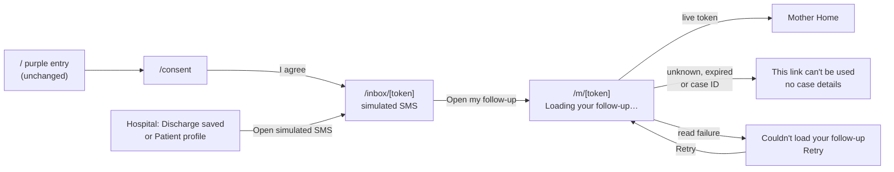

# Mother access links: implementation report

Date: 2026-10-22. Scope: the mother's entry into her case, as specified by `docs/InaAlaga_PRD.md` and the Figma file "InaAlaga • Mother Experience • English". Mock data source only.

## Decision: private links, not accounts

The PRD and Figma both specify link-based access and exclude a login or registration system:

- PRD §1 defers "OTP/account recovery"; §2 step 4 has the mother open "her scoped demo link from a simulated SMS inbox"; §8 defines `access_tokens` as a hashed random token with case scope and expiry.
- Figma implementation notes: "Mother links: random expiring token, case/session scope, server-side validation. Invalid links reveal no case details. No OTP or production account flow is introduced."

In this flow, **saving a hospital discharge is the mother's registration** (it issues her link), and **opening the link is her sign-in**. The team confirmed this direction before implementation.

## User journey

## What changed

| Area | Change | Files |
| --- | --- | --- |
| Data layer | Token registry `links` (token → case key + `expires_at`); `getCaseByToken` resolves only live tokens; `createDischarge` issues a random 128-bit link valid 14 days from the demo clock; new `getSimulatedMessage`, `getMotherLink`, `getDemoMotherToken`; storage now `{ cases, links }` under key `inaalaga-mock-store-v2`, re-read on every call | `web/src/lib/data/mock.js`, `index.js`, `supabase.js` (stubs) |
| Simulated inbox | New route matching the "Your follow-up link" frame | `web/src/app/(mobile)/inbox/[token]/page.js` |
| Access states | Loading skeleton, load failure with Retry, invalid link, all on a shared shell | `web/src/components/AccessShell.js`, `InvalidLink.js`, `web/src/app/(mobile)/m/[token]/layout.js` |
| Entry | Consent now opens Maria's simulated inbox instead of `/m/ia-0042` | `web/src/app/(mobile)/consent/page.js` |
| Hospital | "Mother's demo link" on the Discharge saved step and in the patient profile | `web/src/components/hospital/MotherLink.js`, `DischargeDialog.js`, `PatientProfile.js` |
| Strings | New FIL and EN strings; footnote and invalid-link copy from Figma | `web/src/lib/i18n.js` |
| Toggle | `tone="light"` variant for lilac pages | `web/src/components/LangToggle.js` |
| Lint fix | Effect no longer calls a state-setting function synchronously | `web/src/lib/caseContext.js` |
| Tests | Node built-in test runner, no new dependency; `npm test` | `web/test/mother-access.test.mjs`, `web/test/alias-hooks.mjs`, `web/package.json` |
| Docs | Conventions, demo URLs, issue status | `web/CLAUDE.md`, `docs/architecture/*` |

## Requirement status

| Requirement | Figma frame | Status | Verified by |
| --- | --- | --- | --- |
| Link from a simulated SMS (PRD §2.4) | Your follow-up link | Done (mock) | Screenshots 03, 04, 11; test |
| Saving a discharge issues the link | (hospital) | Done (mock) | Screenshot 10; tests |
| M01: other case IDs and expired tokens reveal nothing | This link can't be used | Done in browser; **not server-enforced** | Screenshots 07, 08; tests |
| Loading and read-failure states | Loading your follow-up…, Couldn't load your follow-up | Done | Code review; not captured (see below) |
| Hashed tokens validated server-side (PRD §8) | Implementation notes | **Blocked**: no server routes or database | — |
| Purple entry screen kept | — | Unchanged | Screenshot 01; `git diff` |

## Verification

| Command | Result |
| --- | --- |
| `npm test` (in `web/`) | 12 passed, 0 failed |
| Same suite with the expiry check deliberately removed | 2 failed, as expected; the tests can detect the bug |
| `npm run lint` | Passed, 0 problems (including the new test files) |
| `npm run build` | Passed; `/inbox/[token]` listed as a dynamic route |
| Browser walkthrough (Chrome, dev server) | Entry → consent → inbox → Home; expired and case-ID links rejected; hospital save → new link → new mother's Home |

Lint and build ran in a scratch copy with dependencies installed, because `npm ci` fails on the existing lockfile drift and `npm install` would rewrite the tracked lockfile.

## Screenshots

All in `screenshots/` beside this report. Mother screens are cropped to the 430 px mobile shell; hospital screens are full desktop viewport.

| File | Shows |
| --- | --- |
| [01-entry-purple-unchanged.png](screenshots/01-entry-purple-unchanged.png) | Existing purple entry screen, unchanged |
| [02-consent.png](screenshots/02-consent.png) | Consent; "I agree" now leads to the simulated inbox |
| [03-simulated-inbox-fil.png](screenshots/03-simulated-inbox-fil.png) | Simulated inbox, Filipino |
| [04-simulated-inbox-en.png](screenshots/04-simulated-inbox-en.png) | Simulated inbox, English (Figma "Your follow-up link") |
| [05-mother-home-via-link.png](screenshots/05-mother-home-via-link.png) | Maria's Home opened through her link |
| [06-expired-link-sms.png](screenshots/06-expired-link-sms.png) | An expired link's SMS still displays |
| [07-expired-link-rejected.png](screenshots/07-expired-link-rejected.png) | Opening it: "This link can't be used", no case details |
| [08-case-id-url-rejected-fil.png](screenshots/08-case-id-url-rejected-fil.png) | Old `/m/ia-0042` URL rejected (Filipino) |
| [09-hospital-profile-mother-link.jpg](screenshots/09-hospital-profile-mother-link.jpg) | Patient profile with "Mother's demo link" and expiry |
| [10-discharge-saved-mother-link.jpg](screenshots/10-discharge-saved-mother-link.jpg) | Discharge saved for new case IA-0048, with its link |
| [11-new-mother-inbox.png](screenshots/11-new-mother-inbox.png) | IA-0048's simulated inbox from that link |
| [12-new-mother-home.png](screenshots/12-new-mother-home.png) | IA-0048's Home, completing hospital → mother |

Not captured: the loading skeleton (visible for about 250 ms) and the load-failure screen (the mock never fails reads). Both are covered by code review only.

## Design deviations

- **Language toggle on access screens.** The Figma frames are English-only with no toggle; the app's mother views are bilingual (`web/CLAUDE.md`), so a light-styled FIL/EN toggle is shown top right.
- **Greeting uses the full alias** ("Hello, Maria Santos.") because the data has no separate first name.
- **Filipino copy** for the new strings is a draft and needs team review.
- **Home, Visits and Stations** were not changed: they still use the current four-tab layout, not the Figma three-tab redesign (separate task).

## Known limitations and follow-ups

1. **Not real access control.** Tokens are stored in the browser and seeded in the JS bundle, and are not hashed. PRD §8 requires server-generated, hashed tokens validated in route handlers before any real use.
2. **Old URLs stop working.** `/m/ia-00NN` and `/m/preview-*` are rejected by design; use the token URLs in `docs/architecture/DEVELOPMENT_GUIDE.md`.
3. **Saved demo data resets once** because the storage key changed to `-v2`.
4. **Language resets to Filipino on every full page load** (pre-existing), so a link opened in a new tab starts in FIL.
5. **Reset in one tab** does not clear another open tab's in-memory copy until that tab's next data call finds stored data.
