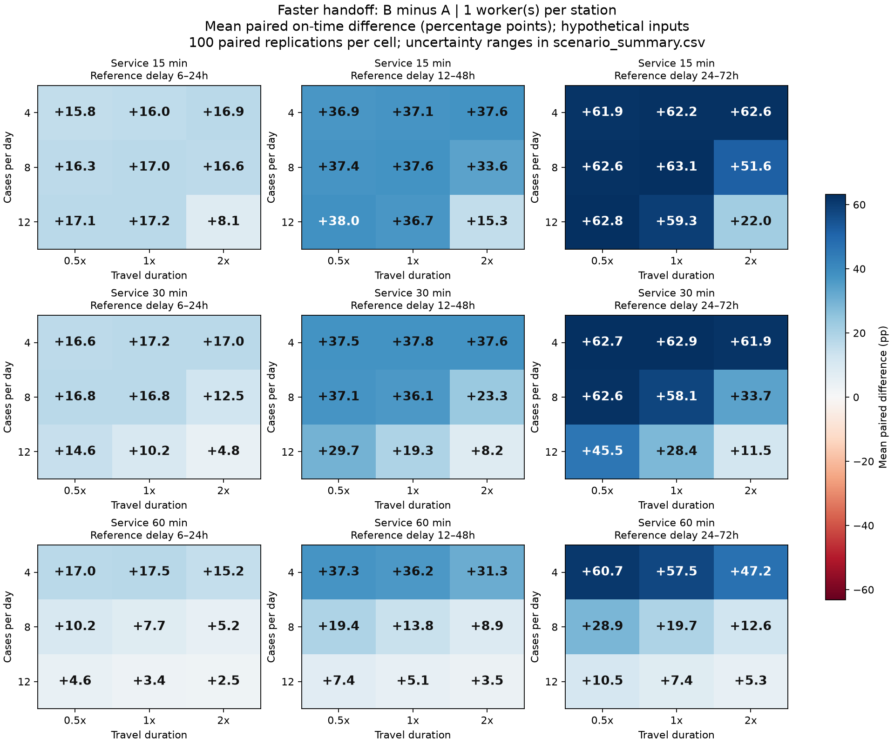
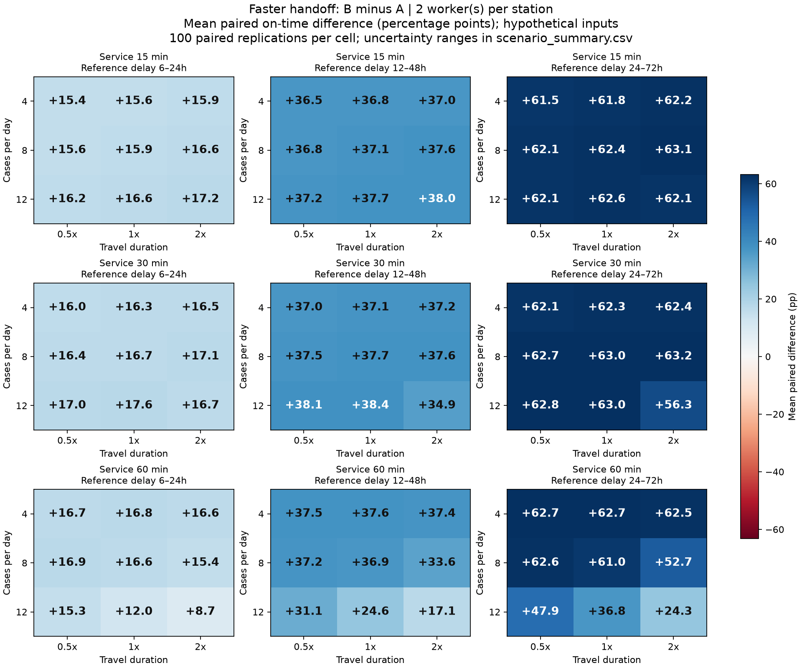
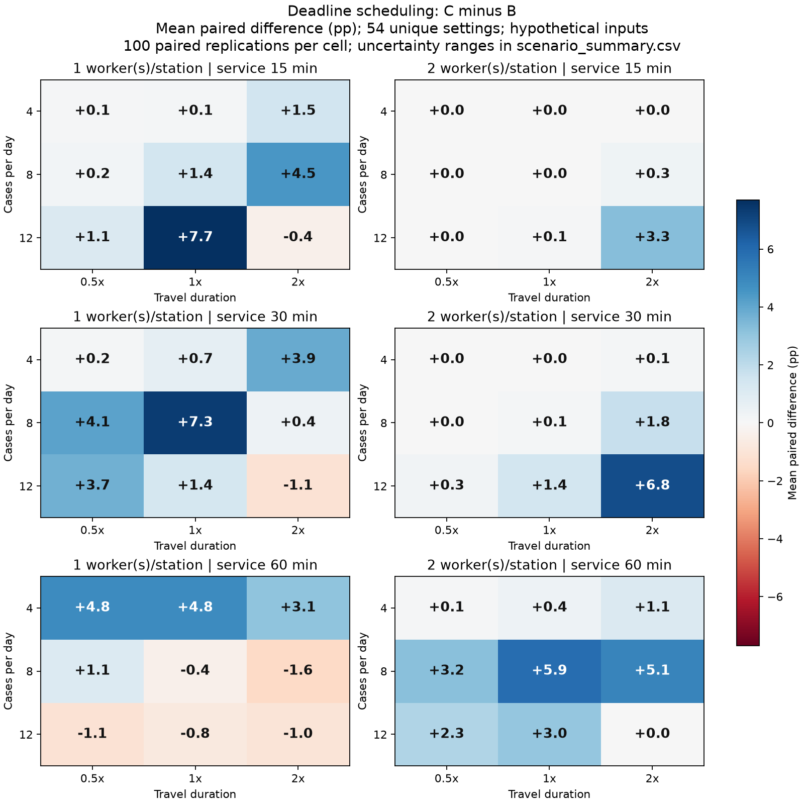

# Full-factorial uncertainty findings

162 configurations × 100 matched replications × four policies = **64,800 policy runs**. The design was saved before these runs. Model v1.0.0 is unchanged; the original 30-configuration results remain separate in `../../results/v1/`. This is an exploration of assumed conditions, not a forecast for Tuguegarao.

## Design and interpretation

Demand 4/8/12 per day; 1/2 workers per station; service 15/30/60 minutes; travel 0.5x/1x/2x; reference handoff 6–24/12–48/24–72 hours. Faster handoff remains 0–6 hours. All other parameters remain fixed: 14 arrival days, 7 drain days, 09:00–13:00 shifts, 24/48/72-hour administrative deadlines, zero initial backlog, successful served contacts, pilot v2 and its 60/40 expected station demand split.

A/B compare handoff delay at fixed FIFO scheduling. B/C compare scheduling at the same faster handoff and same resources. D uses reference handoff plus EDF. Worker counts are separate resource scenarios; staffing gains must not be attributed to scheduling. The complete raw design and all 162 scenario summaries are linked below.

The reference-delay axis does not affect B or C. Therefore their 162 grid entries contain **54 distinct B/C parameter settings**, each repeated three times across the reference-delay axis with identical outputs. Their repeated appearances are not independent evidence. Seed draws are paired across scenarios as well as policies, so scenario outcomes are correlated.

## Results across the stated grid

B−A means: 162 positive, 0 zero, 0 negative across 162 configurations; range 2.54 to 63.15 percentage points.

C−B means: 44 positive, 3 zero, 7 negative across the 54 distinct settings; range -1.55 to 7.70 percentage points.

These signs classify the mean differences numerically, not statistical significance, practical importance, or the chance a policy helps in the real city. All intervals are the central 95% range of seed-level differences, not confidence intervals for the mean or local effectiveness. Counts across equally spaced grid settings do not estimate how frequently those conditions occur locally.

## Complete scheduling comparison (B/C; reference-delay duplicates collapsed)

| Demand/day | Workers/station | Service min | Travel multiplier | C−B mean pp | Central 95% simulation range | Replications C worse |
| --- | --- | --- | --- | ---: | --- | ---: |
| 4 | 1 | 15 | 0.5 | 0.07 | [0.00, 1.56] | 0% |
| 4 | 1 | 15 | 1 | 0.15 | [0.00, 1.92] | 0% |
| 4 | 1 | 15 | 2 | 1.46 | [0.00, 6.94] | 1% |
| 4 | 1 | 30 | 0.5 | 0.16 | [0.00, 2.10] | 0% |
| 4 | 1 | 30 | 1 | 0.70 | [0.00, 3.78] | 0% |
| 4 | 1 | 30 | 2 | 3.87 | [0.00, 11.45] | 1% |
| 4 | 1 | 60 | 0.5 | 4.82 | [-0.83, 13.18] | 3% |
| 4 | 1 | 60 | 1 | 4.83 | [-6.17, 13.57] | 12% |
| 4 | 1 | 60 | 2 | 3.12 | [-8.33, 15.33] | 26% |
| 4 | 2 | 15 | 0.5 | 0.00 | [0.00, 0.00] | 0% |
| 4 | 2 | 15 | 1 | 0.00 | [0.00, 0.00] | 0% |
| 4 | 2 | 15 | 2 | 0.03 | [0.00, 0.00] | 0% |
| 4 | 2 | 30 | 0.5 | 0.00 | [0.00, 0.00] | 0% |
| 4 | 2 | 30 | 1 | 0.02 | [0.00, 0.00] | 0% |
| 4 | 2 | 30 | 2 | 0.15 | [0.00, 2.13] | 0% |
| 4 | 2 | 60 | 0.5 | 0.11 | [0.00, 1.72] | 1% |
| 4 | 2 | 60 | 1 | 0.42 | [0.00, 3.78] | 0% |
| 4 | 2 | 60 | 2 | 1.12 | [0.00, 6.02] | 1% |
| 8 | 1 | 15 | 0.5 | 0.20 | [0.00, 1.33] | 0% |
| 8 | 1 | 15 | 1 | 1.43 | [0.00, 4.45] | 0% |
| 8 | 1 | 15 | 2 | 4.50 | [-7.05, 15.94] | 23% |
| 8 | 1 | 30 | 0.5 | 4.14 | [0.00, 12.61] | 0% |
| 8 | 1 | 30 | 1 | 7.29 | [-3.46, 16.67] | 8% |
| 8 | 1 | 30 | 2 | 0.42 | [-11.72, 13.15] | 44% |
| 8 | 1 | 60 | 0.5 | 1.06 | [-4.40, 7.24] | 30% |
| 8 | 1 | 60 | 1 | -0.37 | [-7.05, 9.73] | 52% |
| 8 | 1 | 60 | 2 | -1.55 | [-5.61, 2.81] | 74% |
| 8 | 2 | 15 | 0.5 | 0.02 | [0.00, 0.00] | 0% |
| 8 | 2 | 15 | 1 | 0.03 | [0.00, 0.44] | 0% |
| 8 | 2 | 15 | 2 | 0.35 | [0.00, 2.34] | 0% |
| 8 | 2 | 30 | 0.5 | 0.04 | [0.00, 0.82] | 0% |
| 8 | 2 | 30 | 1 | 0.14 | [0.00, 1.31] | 0% |
| 8 | 2 | 30 | 2 | 1.79 | [0.00, 6.18] | 1% |
| 8 | 2 | 60 | 0.5 | 3.22 | [0.00, 8.92] | 1% |
| 8 | 2 | 60 | 1 | 5.86 | [-0.92, 15.58] | 3% |
| 8 | 2 | 60 | 2 | 5.08 | [-7.12, 18.26] | 18% |
| 12 | 1 | 15 | 0.5 | 1.10 | [0.00, 5.07] | 0% |
| 12 | 1 | 15 | 1 | 7.70 | [-0.32, 18.31] | 3% |
| 12 | 1 | 15 | 2 | -0.38 | [-7.19, 6.10] | 51% |
| 12 | 1 | 30 | 0.5 | 3.72 | [-5.26, 13.03] | 19% |
| 12 | 1 | 30 | 1 | 1.35 | [-4.15, 10.34] | 39% |
| 12 | 1 | 30 | 2 | -1.11 | [-4.67, 2.80] | 65% |
| 12 | 1 | 60 | 0.5 | -1.10 | [-3.76, 1.42] | 69% |
| 12 | 1 | 60 | 1 | -0.78 | [-4.15, 2.84] | 68% |
| 12 | 1 | 60 | 2 | -0.99 | [-3.09, 1.23] | 69% |
| 12 | 2 | 15 | 0.5 | 0.01 | [0.00, 0.00] | 0% |
| 12 | 2 | 15 | 1 | 0.06 | [0.00, 0.64] | 0% |
| 12 | 2 | 15 | 2 | 3.28 | [0.00, 9.30] | 1% |
| 12 | 2 | 30 | 0.5 | 0.25 | [0.00, 1.88] | 0% |
| 12 | 2 | 30 | 1 | 1.44 | [0.00, 5.20] | 0% |
| 12 | 2 | 30 | 2 | 6.82 | [-7.28, 20.79] | 12% |
| 12 | 2 | 60 | 0.5 | 2.31 | [-5.60, 11.62] | 28% |
| 12 | 2 | 60 | 1 | 3.00 | [-7.35, 18.01] | 27% |
| 12 | 2 | 60 | 2 | 0.00 | [-6.53, 7.14] | 48% |

## How to use these results

Read conditional cells and their intervals rather than selecting one headline percentage. Faster handoff gains depend on the assumed reference-delay ranges and short administrative deadlines; none of those delay ranges has been measured locally. EDF is not an optimal scheduler for maximizing on-time completions: it can spend capacity on already-overdue jobs, and the shared head-of-line rule can leave end-of-shift time unused. A ranking reversal is a model finding, not a reason to remove a scenario.

`staffing_comparisons.csv` separately reports paired two-worker-minus-one-worker gains for each unchanged policy. `capacity_scheduling_interactions.csv` shows how the C−B scheduling difference changes with worker capacity. Those are additional-resource comparisons/conditional interactions, not proof that the software creates capacity.

No local workflow review, operational timestamp calibration, service-eligibility confirmation, or clinical validation has been added by this experiment. Demand, hours, service, delay and travel remain assumptions. Initial backlog, alternate deadline distributions, unsuccessful attempts and station-location/assignment uncertainty are not varied here; see the original sensitivities and limitations. The original geographic caveats persist.

## Reproduction and artifacts

From project root: `python3 -m simulation.factorial --replications 100`. See `../../README.md` for model rules and `../../factorial_report.py` for this report builder. Tables and raw inputs/results: [full scenario table](../../results/factorial_v1/scenario_summary.csv), [frozen design](../../results/factorial_v1/experiment_design.json), [results JSON](../../results/factorial_v1/results.json), [all seed-level policy metrics](../../results/factorial_v1/replications.csv), [paired differences](../../results/factorial_v1/paired_differences.csv).

Heatmaps show mean paired percentage-point differences, with consistent color scales within each comparison. White is zero; warm negative colors indicate the alternative has a lower mean on-time rate, cool positive colors indicate higher. Every cell is annotated; uncertainty remains in the full table. C−B panels collapse the redundant reference-delay axis.

